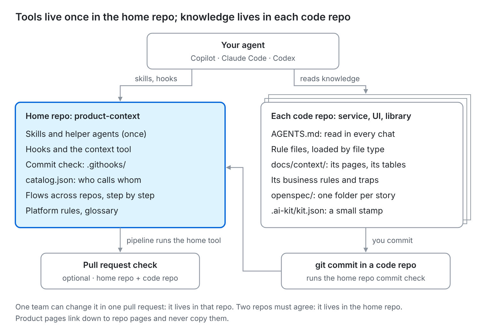

# AI Context Kit: Architecture

Kit 2.3.1 · November 2026. For engineering leaders, architects and anyone evaluating the kit. How to set it up is
in [GUIDE.md](GUIDE.md); how to roll it out across an organisation is in [ORG-LEVEL.md](ORG-LEVEL.md).

## Summary

The AI Context Kit (MIT licence) is a set of plain files installed into each repo that gives AI coding
agents (GitHub Copilot, Claude Code, OpenAI Codex, and any agent that reads `AGENTS.md`) correct, current
knowledge of an existing system, and makes every story follow plan → approve → fresh-eyes review →
test-first build → review. It contains no server and no database: just text files, eight skills in each repo
(two more in a product's home repo), two agents, one checking script (which can also run as an MCP server),
git hooks, an optional pull request check, an installer and a setup planner that any agent can drive, plus two
optional open-source tools (OpenSpec for the story workflow, Graphify for the code map).

It does not make the agent a better programmer. It gives it a short, reviewed memory of the system and the
knowledge that is not in the code (what a status value means, why something is deliberate, which service
relies on which event), and it puts a plan review and tests first around every story. Published studies
and our own first test show that this helps when the context is short and checked by people, and hurts when
it is long or machine-written (see "Research" and "Limits" below).

Five principles shape every part of it:

1. **Little always-loaded, the rest on demand.** One short file is read on every request; detail is read only
   when the task needs it.
2. **Generate what code can tell you; write only what it can't.** Tables of columns, endpoints and
   dependencies come from code. People write rules, traps and the "why".
3. **Every fact is traceable.** Each statement about code carries an anchor pointing at the file it
   describes, so the kit can tell when it may have gone wrong.
4. **People approve; machines check.** A developer approves the plan and the pull request. Hooks and checks
   catch out-of-date knowledge automatically.
5. **The knowledge belongs to no tool.** Everything that matters is Markdown in the repo, readable by any
   agent; the per-tool parts are thin adapters that can be added or removed. See [ROADMAP.md](ROADMAP.md).

## At a glance

The agent is the only part that writes code. It follows the skills and reads the knowledge it needs. The
checks flag knowledge whose code has changed so someone re-reads it, and block a commit only when knowledge
points at a file that no longer exists. OpenSpec and Graphify are optional; the core is plain files and one
script.

## Components

**Kit-owned** files are replaced by `--upgrade`; **team-owned** files are never touched again by the kit;
**org-owned** files are replaced by each sync from the organisation context repo.

### Knowledge (what the agent reads)

| Component | Installed at | What it does | Owner |
| --- | --- | --- | --- |
| `AGENTS.md` | Repo root | One-page always-read file: commands, top rules, traps, "where to look" index. Under 150 lines. | Team |
| Rule files | `.github/instructions/*.instructions.md` (Claude Code: `.claude/rules/`) | Short rules for one kind of file, loaded only when the agent touches matching files (`applyTo` / `paths`) | Team |
| Organisation rules | `.github/instructions/org/` | The org's rules, copied in and stamped by `install.mjs --org` | Org |
| Dimension pages | `docs/context/architecture.md`, `domain.md`, `screens.md`, `data.md`, `api.md`, `dependencies.md`, `security.md`, `testing.md`, `operations.md` | In-depth reference, one page per readiness dimension, read on demand | Team |
| Table pages | `docs/context/data/tables/`, `data/index.md` | One page per table: structure generated from a schema file, meaning written by people | Team (generated part: `schema-import`) |
| Decision pages | `docs/context/decisions/` | Why things are the way they are | Team |
| Area pages | `docs/context/areas/` | Deep pages for one complex flow or format, added after a story needed one | Team |
| Known traps | `docs/context/known-traps.md` | Things that look wrong but are deliberate | Team |
| Readiness ratings | `docs/context/readiness.md` | Latest 0–5 rating per dimension, with evidence | Team |
| Behaviour specs | `openspec/specs/` | What the system must do, as requirements and scenarios; grows as stories are archived | Team (via stories) |
| Product pages | The product's home repo: `catalog.json`, `context/` (system map, flows across repos, platform rules, glossary) | Only what spans repos; links down to repo pages, never copies them | Product tech leads |
| Code map | `graphify-out/` (not committed) | Searchable map of which class calls which, rebuilt locally after every commit | Generated |

### Instructions (skills and agent)

| Component | When used | What it does |
| --- | --- | --- |
| `/context-create` | Once per repo | Drafts `AGENTS.md`, rule files, architecture and traps from five questions and the code |
| `/context-create deep` | One page at a time, when a story or a mistake shows the knowledge is needed | Writes in-depth pages and table pages, anchored, with Unverified lists |
| `/context-assess` | After review, then each sprint or quarter | Rates each dimension 0–5 within evidence caps; the tool computes the score |
| `/story-start` | Start of each story | Reads the story, searches every repo in the window, groups repos, sizes the story, creates one change per repo |
| `/story-finish` | End of each story | Tests per scenario, impact, context check, area page offer, PR description |
| `/context-update` | When checks flag stale lines, after a migration or a kit upgrade | Fixes only the flagged lines; converts page format; refreshes table pages |
| `/context-learn` | When the agent was corrected | Turns the correction into a permanent rule |
| `/onboard-me` | A new joiner's first day | 30-minute guided tour from the same knowledge |
| `/kit-setup` | Adding a repo or an agent, the pull request check, an upgrade, "is it working?" | Follows `kit/SETUP-AGENT.md`: asks once, shows the setup plan, runs it after a yes |
| Context-steward agent | Monthly or on request | A restricted agent that may only edit knowledge files; a guard hook blocks code and org-rule edits |
| Design-reviewer agent | After the change's documents exist | Read-only review with no memory of the chat that wrote the plan: traceability, truth to the code, rules, contracts, tests, context impact |
| `/product-context` (home repo or hub) | Once the repos have context; `update` after repos are added or removed | Writes the system map, end-to-end flows, glossary and platform rules, anchored into the repos |
| `/cross-repo-story` (home repo or hub) | A story that changes several repos | One plan that links each repo's change |

All skills are kit-owned and installed per tool: `.github/skills/` (Copilot), `.claude/skills/` (Claude Code),
`.agents/skills/` (Codex). Every skill ends its reply with **What changed · Checks · Next**, so the person sees
the result whether or not the agent hooks run.

### Automatic checks

| Component | Installed at | When it runs | What it does |
| --- | --- | --- | --- |
| Context tool | `.ai-kit/context-tools.cjs` (one file, no dependencies) | Called by every check below | Reads anchors and page metadata; `check`, `status`, `doctor`, `readiness`, `pages-for`, `migrate`, `schema-import`, `review`, `ci`, `mcp` and four hook commands; logs each hook run in `.git/ai-kit/` |
| Agent hooks | `.github/hooks/ai-context.json` (Copilot), `.claude/settings.json` (Claude Code) | Chat start, after each edit, before the agent finishes | Health note; "this file is described by line 12"; one request to re-check lines the agent's own edits touched. Duplicate calls ignored |
| Git hooks | `.githooks/pre-commit`, `post-commit`, `post-merge`, `post-checkout` | Commit, merge, branch switch | Refuse commits with broken anchors; warn about the rest (including table pages out of date with the schema file or the code); rebuild the code map in the background |
| PR template | `.azuredevops/pull_request_template.md` | Every pull request | Checklist: plan reviewed, every scenario tested, knowledge updated |
| Pull request check (optional) | A step or job added to the pipeline the repo already has (`kit/snippets/ci-step-*.yml`), or a separate pipeline file with `--ci azure` / `--ci github` | Every pull request, whoever or whatever wrote it | `context-tools ci`: the check, a story check, the readiness score. The kit never edits an existing pipeline |
| MCP server (preview) | `context-tools.cjs mcp`, registered with `--mcp` | When an agent calls it | The same questions the hooks answer, for agents that work without the editor |

### Workflow and tooling

| Component | Installed at | What it does | Owner |
| --- | --- | --- | --- |
| OpenSpec settings | `openspec/config.yaml` | A short `context` block (read `AGENTS.md` first) and test-first guidance for OpenSpec's default workflow | Team |
| Code map connection | `.vscode/mcp.json`, `.graphifyignore` | Lets the agent query Graphify; keeps kit and story files out of the map | Team |
| Version stamp | `.ai-kit/kit.json` | Which kit version, which tools and which org rules this repo runs | Kit |
| Readiness weights | `.ai-kit/readiness.json` | Weights and bands, usually synced from the org | Org or team |
| Setup planner | `kit/setup.mjs`, `kit/SETUP-AGENT.md` | Finds the repos next to the kit, works out the install or upgrade steps from what is on disk, shows them, runs them after a yes; skips repos with uncommitted changes; never commits or pushes | Kit repo only |
| Installer | `kit/install.mjs` | The steps the planner runs: installs, upgrades, syncs org rules, creates workspaces, hubs and org repos; never overwrites team files | Kit repo only |
| Product hub template | `kit/hub-template/` | Catalogue, platform rules, flows, contracts, `/product-context`, `hub.mjs` | Created once per product |
| Org template | `kit/org-template/` | Org rules, shared platforms, AI usage policy, kit version, readiness weights | Created once per organisation |

## Knowledge model

Knowledge is sorted by **when the agent needs it**, so the cost of each request stays small no matter how
much the team documents.

| Layer | Loaded | Holds | Size limit | Why |
| --- | --- | --- | --- | --- |
| Always | Every request | `AGENTS.md`, org rules with `applyTo: '**'` | 150 lines, about 2,000 tokens in total | Everything here costs on every request; long always-loaded files made agents worse in studies |
| Per file type | When the agent touches matching files | Rule files with `applyTo` | 30–60 lines each | The right rule at the right moment |
| On demand | When the task needs it (pointed to from `AGENTS.md`) | Dimension pages, area pages, decisions, traps, specs | 60–250 lines a page | Depth without carrying it on every request |
| Generated | Queried, never loaded whole | Code map; generated parts of table pages | None | Rebuilt from code by a command, not written by hand. Stale until rebuilt or re-imported; the checks say when |

**Anchors.** Any statement that depends on code ends with an anchor, for example
`- Exports are capped at 50,000 rows [anchor: src/main/java/**/ReportExportService.java]`. An anchor can be
a file, a folder, a glob or several of these. In the product hub, anchors name the repo:
`[anchor: report-service:src/.../ReportController.java]`. The checks use anchors three ways:

- **Broken:** the anchored file no longer exists, so the line is certainly wrong. Commits are refused.
- **Stale:** the anchored file changed but the line didn't, so the line may be wrong. Flagged for a look.
  The check knows only which file changed, not what changed in it: a rename flags the line as much as a
  change of logic, and logic that moves to a file nothing points at is not flagged at all. Someone (the agent
  that made the edit, or the reviewer) still judges whether the line is true.
- **Provenance:** the share of statements with anchors is part of the readiness score.

**Page metadata.** Each in-depth page starts with frontmatter the tools read, following the Open Knowledge
Format (OKF v0.3): `type`, `status` (draft, stable, deprecated), `verified` (a list of review events) and
`generated` for machine-written pages, plus the kit's own `dimension` and `owner`. A page starts as `draft`;
its owner reviews it against the code, sets `stable` and adds a `human:` review event; a second person who
didn't write it adds a second event (independent review). Reviews older than a page's `generated` date stop
counting, so a regenerated table page needs a fresh look. Generated pages without a human review are
traceable but count as unreviewed.

**The dimension pages** follow the 12-dimension readiness framework:

| Dimension | Weight | Where it lives | Generated or written |
| --- | --- | --- | --- |
| Code understanding | 15% | `AGENTS.md`, rule files, code map | Written; code map generated |
| Architecture | 10% | `architecture.md` | Written; most-connected parts from the code map |
| Business/domain | 10% | `domain.md`, `screens.md`, `openspec/specs/` | Written; specs grow with each story |
| Data | 10% | `data.md`, `data/tables/` | Table structure generated from a schema file; meaning written |
| API/integration | 10% | `api.md` | Endpoints generated from OpenAPI or controllers |
| Dependencies | 10% | `dependencies.md`, hub catalogue | Generated from build files and the catalogue |
| Security | 10% | `security.md` | Written, anchored to security config |
| Testing | 5% | `testing.md` | Written |
| Runtime/operations | 5% | `operations.md` | Written, anchored to config and pipelines |
| Decision history | 5% | `decisions/`, archived designs | Written per decision |
| Provenance | 5% | All pages | Measured: share of statements anchored |
| Freshness | 5% | All pages | Measured: broken anchors, code changed since review, review age |

## When each part runs

The agent hooks (the first three moments) work inside the chat and only ever add a note or ask once. The
commit check is the one hard stop, and it only blocks knowledge that points at a file that no longer exists.
Every check calls the same context tool, so a rule is defined once.

## Story workflow

Each story that changes behaviour gets a folder per repo it changes, `openspec/changes/<change-id>/`, with
OpenSpec's own documents, created in a fixed order:

| Order | Document | Holds | Created by | Needs |
| --- | --- | --- | --- | --- |
| 0 | `context.md` | The story pack: acceptance criteria, files per repo, rules, open questions | `/story-start` | — |
| 1 | `proposal.md` | Why and what changes | `/opsx-propose` | — |
| 2 | `specs/<capability>/spec.md` | Required behaviour as requirements and when/then scenarios | `/opsx-propose` | proposal |
| 3 | `design.md` | Only when needed: approach, decisions, risks | `/opsx-propose` | proposal |
| 4 | `tasks.md` | Ordered tasks; the kit's config asks for each test before its code | `/opsx-propose` | specs (and design) |

Then the design reviewer checks the plan with fresh eyes, a person approves it, `/opsx-apply` works
through the tasks, `/opsx-verify` checks the code against the specs, and `/story-finish` checks every
scenario has a passing test. `/opsx-archive` merges the specs into `openspec/specs/`, the permanent record.
Tiny fixes skip the folder: failing test, fix, finish. Without OpenSpec, `/story-start` writes one
`plan.md` instead. A team's own technical design or test-scenario format runs as its own skill after
`/opsx-propose`, so OpenSpec itself stays unchanged and upgrades cleanly.

## Many repos

- **A product workspace is the recommended setup for two or more repos.** One home repo holds the kit's
  skills, agents, hooks and tool once, plus the product pages. Each code repo holds only its own knowledge
  and a small stamp, and its commit check and pull request check run the home repo's tool. The setup planner
  suggests a workspace as soon as a second repo is next to the kit, and moves a repo that had its own copy
  into it without touching its knowledge.
- **Each repo owns its knowledge.** Its rules and pages are reviewed in its own PRs, because they change with
  its code. A repo can also be set up on its own, with its own copy of the kit, when a team works on it alone.
- **What goes where.** If one team can change it in one pull request, it lives in that repo: how the repo is
  built, its traps, its business rules, its tables, the API it offers and the calls it makes. If changing it
  needs two repos to agree, it lives in the home repo: who calls whom (`catalog.json`), end-to-end flows as
  5–10 steps with one line per step and a link to the repo page for the detail, field mapping across repos,
  the events and endpoints one repo relies on from another, platform rules, the glossary. Product pages link
  down and never copy.
- **One story, one change per repo that changes, same change id.** `/story-start` searches every repo in
  the window and sorts them into *changes*, *read only* and *connected but not open*. Producers are planned
  and built first (services, then UIs); each repo gets its own branch and PR, linked to each other.
- **Incoming callers are the hard case.** A repo can see what it calls, not who calls it. `hub.mjs impact`
  lists repos that call or load the ones being changed, from the catalogue, including repos not open. The
  catalogue is empty until `/product-context` fills it.
- **A product hub** (`--create-hub`) is the older form of the home repo, for repos that each keep their own
  copy of the kit. It holds the same product pages.

## Organisation level

The kit has five layers of context. Each holds only what is true at its level, has one owner, and reaches the
agent in the way that suits how often it changes. Details and rollout: [ORG-LEVEL.md](ORG-LEVEL.md).

| Layer | Holds | Lives in | Owner | How it reaches the agent |
| --- | --- | --- | --- | --- |
| 1. Organisation | Rules every repo must follow (secrets, personal data, identity and permission services, API error format, AI usage), shared platforms, readiness weights, kit version | One org context repo (`--create-org`) | Architecture / engineering excellence group | Rule files copied into each repo by `install.mjs --org`, stamped with the org repo's commit |
| 2. Product | Catalogue of repos, system architecture, end-to-end flows, glossary, product platform rules | The product workspace's home repo (or a product hub) | Product tech leads | Opened with the repos in the agent's window; read on demand |
| 3. Repo | `AGENTS.md`, rule files, in-depth pages, specs, code map | Each repo | The team that owns the repo | Loaded by the agent (always, per file type, or on demand) |
| 4. Story | Proposal, specs, design (if needed), tasks | `openspec/changes/<id>/` in each repo it changes | The developer, approved by a reviewer | Read during that story; merged into specs on archive |
| 5. Personal | Each developer's own preferences | Their VS Code profile | The developer | Loaded only for them; never holds team rules |

Organisation rules are copied rather than linked because GitHub's organisation-level instructions require
GitHub-hosted repos on Copilot Business or Enterprise and don't apply to local editor sessions, and VS Code's
extra-folder settings are per machine. A copy works for every developer, every agent and the pipeline, and
changes to it are visible in pull requests. The kit keeps copies current: each copied rule carries a stamp,
`context-tools check` warns when a copy is older than the local org clone or was edited in the repo, the
agent is told not to edit org rules and the steward is blocked from it, and `--upgrade` re-syncs.

## Keeping context current

Knowledge changes in the same pull request as the code it describes, and five safety nets catch what people
miss. Each later net exists because the earlier ones can be skipped.

| Net | Trigger | What it catches | Who acts |
| --- | --- | --- | --- |
| 1. Design review | Before code | The fresh-eyes reviewer lists the context pages the plan makes out of date (`pages-for` on the files it changes) | Agent, approved by the developer |
| 2. After-edit hook | Each agent edit | "This file is described by `data.md` line 14" | Agent |
| 3. Before-finish hook | Agent says it is done | Lines anchored to files it edited that it didn't revisit (asked once) | Agent |
| 4. Commit check | Each commit | Broken anchors: commit refused. Stale lines, table pages out of date with the schema file or the code, a migration without a new schema export: warnings | Developer |
| 5. Story finish | End of story | Pages anchored to changed files updated or still true; stale anchors since main; PR lists context changes | Agent + reviewer |
| 6. Pull request check (optional) | Each pull request | The same check as the commit, whoever or whatever wrote the code | Reviewer |

Behind these, a steward run and `hub.mjs check` catch drift that slipped through, and `/context-learn` turns
every agent correction into a rule. The nets are only as good as their signal: they work per file, so
false alarms are common and some real changes are never flagged (see "Anchors" above). Apart from missing
files they warn rather than block, so updating still depends on people acting on them.

**Readiness score.** `context-tools.cjs readiness` turns the knowledge model into a 0–100 score on the 12
dimensions. Each dimension is rated 0–5, but the tool caps every rating at what the evidence supports, so the
score cannot be raised by writing more:

| Evidence for the dimension | Highest rating allowed |
| --- | --- |
| No page | 0 |
| Draft, or broken anchors in the page | 2 |
| Generated and not reviewed by a person, no anchors, code changed since review, or reviewed over 180 days ago | 3 |
| Reviewed by its owner | 4 |
| Also reviewed by a second person | 5 |

Provenance and freshness are measured directly. `/context-assess` rates each dimension within its cap with
evidence; the tool computes the weighted total, the band and the three biggest gaps. Weights and band names
come from the organisation (`.ai-kit/readiness.json`, synced from the org repo). The report always
prints the always-loaded size next to the score, because a high score with a bloated `AGENTS.md` would mean
worse agent results, not better. `hub.mjs status` shows every repo's score and the product average.

## Installation, upgrades and ownership

| Command | What it does |
| --- | --- |
| `node kit/setup.mjs` | **The usual way in.** The setup planner: finds the repos next to the kit, asks (in a terminal) or takes choices, shows the plan, runs the installer commands below after a yes. `kit/SETUP-AGENT.md` lets any agent drive it, and `/kit-setup` does the same later |
| `node kit/install.mjs <repo>` | Adds the kit files for Copilot. Never overwrites an existing file; lists what to merge by hand. Running it twice changes nothing. |
| `… --graphify` | Also connects the code map and keeps its output out of git |
| `… --tool claude`, `codex`, `all` | Same kit for Claude Code (`.claude/`, `/opsx:` command names) or Codex (`.agents/skills/`); several tools at once |
| `… --ci azure` / `--ci github` | Optional: a separate pull request pipeline file (never edits an existing pipeline; `kit/snippets/ci-step-*.yml` adds the check to one) |
| `… --mcp` | Registers the kit's MCP server for the chosen tools |
| `… --org <org-context>` | Copies the organisation's rules and readiness weights into the repo, stamped |
| `… --upgrade` | Replaces kit-owned files with this version, moves a 1.x layout to 2.x, re-syncs org rules; team files untouched. Then `context-tools migrate` updates page format, with no AI and no tokens |
| `… --create-workspace <home>` / `<repo> --workspace <home>` | Product workspace: the tools once in a home repo; each repo keeps only its knowledge |
| `… --dry-run` | Shows everything it would do; changes nothing |
| `node kit/install.mjs --create-hub <folder>` | Creates a product context hub |
| `node kit/install.mjs --create-org <folder>` | Creates an organisation context repo |

Beyond copying files, the installer sets the repo's git hooks folder (or, if the repo already has its own
hooks, prints the one line to add so they keep working), writes `.gitattributes` so hook scripts keep Unix
line endings on Windows, adds a short context block and test-first guidance to OpenSpec's settings (OpenSpec
keeps its own default workflow), and records the kit version, tools and org sync in `.ai-kit/kit.json` (no
address unless `--source` is given). Removal is deleting the added folders and one git setting.

## Security and data boundaries

The kit adds no new place where code or data goes. The only component that sends code anywhere is the AI
agent itself, under the organisation's existing Copilot (or Claude) licence and policies.

| Component | Network access | Writes to | Notes |
| --- | --- | --- | --- |
| Context tool, hooks, git hooks | None | Nothing in the working tree; a list of edited files in the system temp folder and a hook log in `.git/ai-kit/` | Exits quietly on any internal error so it cannot break a session |
| MCP server (optional) | None (stdio only) | Nothing | Read-only answers about the repo's context |
| Schema export (run by a person: `pg_dump --schema-only`, a DB viewer's "Generate DDL", or tbls) | The database it is pointed at | `docs/context/data/schema.sql` | Structure only, read-only user, never production. The kit itself never connects to a database |
| Installer, setup planner | None | Only the target repos, only new files (plus kit- and org-owned files on upgrade or sync) | `--dry-run` / `plan` preview everything; repos with uncommitted changes are skipped; never commits or pushes |
| Graphify (optional) | None for `--code-only` | `graphify-out/` locally, not committed | Builds the map from code structure without an AI model |
| OpenSpec (optional) | None for its commands | `openspec/` in the repo | The agent writes the documents; OpenSpec structures and validates them |
| Hub script | None (`clone --run` uses your own git remotes) | The hub folder | Reads sibling repos with `git` |
| Azure DevOps MCP (optional, off by default) | Your Azure DevOps organisation | Work items and PRs, only when asked | Check company policy before enabling |

Controls the kit relies on: people approve the plan and the pull request (the agent never pushes or merges
unless a developer explicitly asks); files that run commands (`.ai-kit/`, `.github/hooks/`, `.githooks/`,
`.claude/settings.json`, `.vscode/mcp.json`, `.mcp.json`) get a named reviewer through CODEOWNERS or an Azure Repos branch policy; tool
versions are pinned to the tested ones; and the steward agent can edit only knowledge files.

## Where it came from

The kit is an original design, developed with AI assistance and tested on sample Java and Angular
repositories with OpenSpec 1.16 and Graphify 0.9.100. It follows public file formats, uses two open-source
tools, and takes its design choices from the published research below. Kit versions up to 2.0 shipped a
workflow schema adapted from OpenSpec's; from 2.1 the kit uses OpenSpec's own default workflow and includes
none of its text (credited in [THIRD_PARTY_NOTICES.md](THIRD_PARTY_NOTICES.md)).

### Formats and platforms it follows

| Source | What the kit takes from it |
| --- | --- |
| AGENTS.md convention | The always-read file's name and role |
| [VS Code: hooks](https://code.visualstudio.com/docs/agent-customization/hooks), [GitHub Copilot hooks reference](https://docs.github.com/en/copilot/reference/hooks-reference) | Hook file format and events |
| [VS Code: custom agent file reference](https://code.visualstudio.com/docs/agents/reference/custom-agent-file-reference.md) | The steward agent's format, tool limits and its agent-scoped guard hook |
| [VS Code: custom instructions reference](https://code.visualstudio.com/docs/agents/reference/custom-instructions-reference.md), [agent skills](https://code.visualstudio.com/docs/agent-customization/agent-skills.md) | Rule files with `applyTo`, `SKILL.md` skills, where VS Code looks for them |
| [GitHub: organisation custom instructions](https://docs.github.com/en/enterprise-cloud@latest/copilot/how-tos/configure-custom-instructions/add-organization-instructions) | Why org rules are synced into repos instead (GitHub-hosted, Business/Enterprise, not local sessions) |
| [VS Code: agent plugins](https://code.visualstudio.com/docs/copilot/customization/agent-plugins) | Considered for distribution; deferred until Azure DevOps support is confirmed |
| [Codex: agent skills](https://learn.chatgpt.com/docs/build-skills) | Codex reads `AGENTS.md` and `.agents/skills/`; the Codex adapter |
| [Model Context Protocol](https://modelcontextprotocol.io) and the Agentic AI Foundation (home of MCP and `AGENTS.md`) | The kit's MCP server; why the core is `AGENTS.md` plus plain Markdown |
| [Open Knowledge Format (OKF v0.3)](https://github.com/open-knowledge-format/open-knowledge-format) | The shape of page frontmatter (`type` required, one subject per file, `index.md`) |
| [Google Elephant-Goldfish Model](https://github.com/google/elephant-goldfish-model) (Apache-2.0) | The idea behind the design reviewer: a reviewer with no memory of the conversation checks the designs. The kit takes the idea, not the code |
| [tbls](https://github.com/k1LoW/tbls) (MIT) | One of the schema file formats `schema-import` reads; the other is a plain DDL dump (`.sql`) |

### Tools it uses (installed separately, not included)

| Tool | Licence | Role | Source |
| --- | --- | --- | --- |
| OpenSpec 1.16 | MIT | Story workflow engine, with its own default workflow; the kit adds only settings | [OpenSpec on a team](https://openspec.dev/docs/team-workflow), [stores](https://openspec.dev/docs/stores) |
| Graphify 0.9.100 | Apache-2.0 | Code map built locally from code structure | [Shared codebase context for teams](https://graphify.com/blog/shared-codebase-context-for-teams.md), [multi-repo code graph](https://graphify.com/blog/multi-repo-code-graph.md) |

### Research behind the design choices

| Finding | Design choice it drove | Source |
| --- | --- | --- |
| AI-written files loaded on every request lowered success slightly and raised cost about 20%; human-written ones helped about 4% (ETH Zurich, 138 repos) | Short always-loaded file; detail on demand; people review drafts | [Evaluating AGENTS.md (arXiv 2602.11988)](https://arxiv.org/html/2602.11988v1) |
| No measurable change in correctness with no guide, an always-on guide or pages read on demand, on 17 tasks with Claude Code and Codex; most failures came from implementation skill | Context is support, not the quality lever: the plan review and test-first tasks carry the quality | [Two-agent ablation (Jul 2026)](https://www.alphaxiv.org/abs/2607.27250) |
| Context files of 100–150 lines did best; the worst did worse than none (AuggieBench). A short "where to look" index in `AGENTS.md` passed every task; skills were not triggered in 56% of cases (Vercel) | `AGENTS.md` about 100 lines with a "where to look" index; the workflow calls skills by name | [mcp.directory summary](https://mcp.directory/blog/claude-md-vs-agents-md-vs-skills-2026) |
| Models get worse as input grows, even on easy tasks | Size budgets and the always-loaded size in every report | [Chroma Research: context rot](https://research.trychroma.com/context-rot) |
| Deep agent docs worked in a 108,000-line codebase, kept on demand; stale docs were the main failure | On-demand pages, anchors, freshness checks | [Codified Context (arXiv 2602.20478)](https://arxiv.org/html/2602.20478) |
| Real teams grow context files in small additions over time | Area pages added as stories need them; updates in the same PR | [Agent READMEs (arXiv 2511.12884)](https://arxiv.org/html/2511.12884v1) |
| Agents followed a simple rule about 65% of the time whatever the file length, less as sessions grow | Hooks that re-surface rules mid-session; important rules also enforced by checks | [Instruction adherence (arXiv 2605.10039)](https://arxiv.org/pdf/2605.10039) |
| Agents rarely follow links from one doc to another | Hooks point the agent at the page for the file it is editing | [How coding agents read documentation (arXiv 2608.20195)](https://arxiv.org/pdf/2608.20195) |
| Most common errors in AI-written docs: omissions and confident wrong "why" | Unverified sections; draft pages capped in the score | [Agent-generated documentation quality](https://codex.danielvaughan.com/2026/06/07/agent-generated-documentation-quality-trust-codex-cli-verification-patterns/) |
| Using tests as the target improved repository-level code generation by about 9.5 points | Test-first tasks; every scenario needs a test | [TENET (arXiv 2509.24148)](https://arxiv.org/abs/2509.24148v2) |
| Teams at scale generate cross-repo maps from code instead of keeping them by hand | Generated system map; hub anchors checked against the repos | [Cross-repo context for agents](https://dev.to/danielwe/ai-coding-agents-need-cross-repo-context-the-teams-running-them-at-scale-are-already-building-it-ek0) |

### Similar work, and how the kit differs

| Work | Overlap | Difference |
| --- | --- | --- |
| [Swimm](https://docs.swimm.io/new-to-swimm/benefits-of-code-coupled-documentation) | Docs tied to code and flagged when code changes (same idea as anchors) | Commercial, built for people; the kit's anchors are a simple open version aimed at agents |
| [Copilot Memory](https://docs.github.com/en/copilot/concepts/agents/copilot-memory) | Repository facts checked against code citations | Built into GitHub (needs GitHub-hosted repos); learned facts rather than a team-reviewed set |
| [ContextDocs](https://littlebearapps.com/builds/contextdocs/) | Generates context files and blocks commits when they are stale | Claude Code only; no story workflow, multi-repo support or code anchors |
| [ai-context-kit plugin](https://www.claudepluginhub.com/plugins/msiccdev-ai-context-kit) | Skills for writing and keeping AGENTS.md files consistent | No hooks or commit checks |
| [Bitovi instruction-generation](https://github.com/bitovi/ai-enablement-prompts) | Generates a full codebase analysis in one run | One-off and loaded on every request; the kit keeps it short, reviewed and current |
| [Meta-repo pattern](https://seylox.github.io/2026/03/05/blog-agents-meta-repo-pattern.html), Backstage software catalogue | A central place describing many repos | The product hub follows the same idea, with anchors checked against the repos |

What is specific to this kit is the combination, aimed at brownfield Java and Angular systems and usable from
Copilot, Claude Code and Codex: small reviewed knowledge with anchors, one tool checking it in chat, at commit and before a PR, the
story workflow with a fresh-eyes plan review and test-first tasks, a product workspace, organisation layers, and an
evidence-capped readiness score.

## Limits and what is not proven yet

Everything above was tested on sample repos on Linux. Still open:

- **The benefit on your code.** Measure it before scaling: the story log (`templates/story-log.md`) records
  premium requests, files read before the first edit, review rounds and rework, with and without the kit.
  A first test on a small sample product (one story, one run each, Claude Code) found that with the kit
  the plan got four facts right that existed only in the context, where without it three were wrong; the
  kit run cost about 2.6 times as much. Where the code itself showed the facts, the two plans were about
  the same.
- **Hooks in live agent chats,** including the steward's agent-scoped guard (a new VS Code feature): check
  them once with `context-tools.cjs doctor` in your own environment.
- **Codex and the MCP server** were tested with scripted calls, not in long live sessions yet.
- **Windows.** Written for Windows; tested on Linux.
- **Skill behaviour varies.** Skills are instructions, not code; the agent can skip a step. The checks exist
  to catch that, and the story log shows how often it happens.
- **Incoming callers across repos** are visible only through the product hub's catalogue, which is
  hand-written today; a generator for it is a planned improvement.
- **Staleness is per file, per day.** A change to an anchored file flags every line anchored to it; a change
  on the same day as a review is not counted.
- **The readiness score measures context, not outcomes.** Read it with the always-loaded size and the story log.
- **Product pages are not yet read by `/story-start` itself.** In the test above the agent found the product
  flow page only because the repo's `AGENTS.md` pointed to it. A fix is planned.
- **Nothing records which pages agents actually read,** so unused pages cannot yet be found and removed.
- **Behaviour can be described in three places** (domain pages, OpenSpec specs, product flow pages) and
  drift apart. Rule: behaviour in specs, structure, traps and reasons in the pages, product pages only link.
- **Rule file path patterns** are drafted from examples; check they match the repo's real folders.
