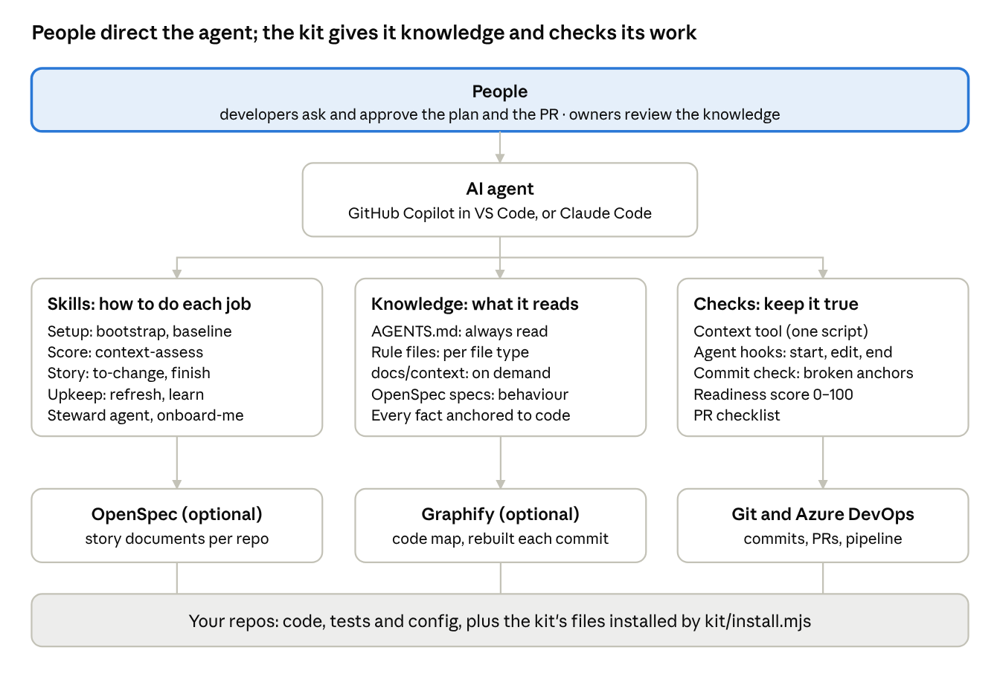
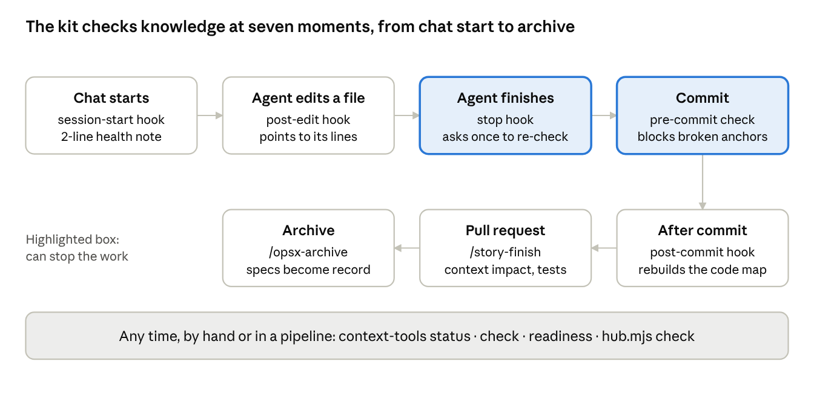
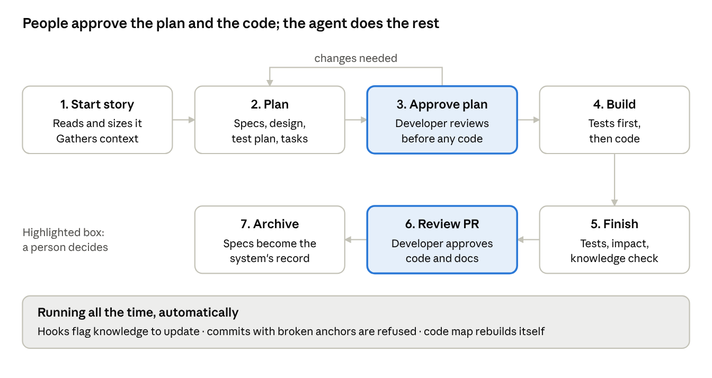

# AI Context Kit: Architecture

Kit 1.6.0 · November 2026. For management, architects and anyone evaluating the kit. How to set it up is
in [GUIDE.md](GUIDE.md); how to roll it out across an organisation is in [ORG-LEVEL.md](ORG-LEVEL.md).

## Summary

The AI Context Kit (MIT licence) is a set of plain files installed into each repo that gives AI coding
agents (GitHub Copilot in VS Code, or Claude Code) correct, current knowledge of an existing system, and
makes every story follow plan → approve → test-first build → review. It contains no server and no database:
just text files, eight skills, one agent, one 600-line checking script, git hooks and an installer, plus two
optional open-source tools (OpenSpec for the story workflow, Graphify for the code map).

Four principles shape every part of it:

1. **Little always-loaded, the rest on demand.** One short file is read on every request; detail is read only
   when the task needs it.
2. **Generate what code can tell you; write only what it can't.** Tables of columns, endpoints and
   dependencies come from code. People write rules, traps and the "why".
3. **Every fact is traceable.** Each statement about code carries an anchor pointing at the file it
   describes, so the kit can tell when it may have gone wrong.
4. **People approve; machines check.** A developer approves the plan and the pull request. Hooks and checks
   catch out-of-date knowledge automatically.

## At a glance

The agent is the only part that writes code. It follows the skills and reads the knowledge it needs, and the
checks warn it (and block commits) when knowledge and code disagree. OpenSpec and Graphify are optional; the
core is plain files and one script.

## Components

**Kit-owned** files are replaced by `--upgrade`; **team-owned** files are never touched again by the kit;
**org-owned** files are replaced by each sync from the organisation context repo.

### Knowledge (what the agent reads)

| Component | Installed at | What it does | Owner |
| --- | --- | --- | --- |
| `AGENTS.md` | Repo root | One-page always-read file: commands, top rules, traps, "where to look" index. Under 150 lines. | Team |
| Rule files | `.github/instructions/*.instructions.md` | Short rules for one kind of file, loaded only when the agent touches matching files (`applyTo`) | Team |
| Organisation rules | `.github/instructions/org/` | The org's rules, copied in and stamped by `install.mjs --org` | Org |
| Dimension pages | `docs/context/architecture.md`, `domain.md`, `screens.md`, `data.md`, `api.md`, `dependencies.md`, `security.md`, `testing.md`, `operations.md` | In-depth reference, one page per readiness dimension, read on demand | Team |
| Decision pages | `docs/context/decisions/` | Why things are the way they are | Team |
| Area pages | `docs/context/areas/` | Deep pages for one complex flow or format, added after a story needed one | Team |
| Known traps | `docs/context/known-traps.md` | Things that look wrong but are deliberate | Team |
| Readiness ratings | `docs/context/readiness.md` | Latest 0–5 rating per dimension, with evidence | Team |
| Behaviour specs | `openspec/specs/` | What the system must do, as requirements and scenarios; grows as stories are archived | Team (via stories) |
| Code map | `graphify-out/` (not committed) | Searchable map of which class calls which, rebuilt locally after every commit | Generated |

### Instructions (skills and agent)

| Component | When used | What it does |
| --- | --- | --- |
| `/context-bootstrap` | Once per repo | Drafts `AGENTS.md`, rule files, architecture and traps from five questions and the code |
| `/context-baseline` | Once per repo, refreshed per page | Writes the in-depth dimension pages, anchored, with Unverified lists |
| `/context-assess` | After review, then each sprint or quarter | Rates each dimension 0–5 within evidence caps; produces the readiness score |
| `/story-to-change` | Start of each story | Reads the story, searches every repo in the window, groups repos, sizes the story, creates one change per repo |
| `/story-finish` | End of each story | Tests, test plan, impact, context check, Context impact table, area page offer, PR description |
| `/context-refresh` | When checks flag stale lines | Fixes only the flagged knowledge lines |
| `/context-learn` | When the agent was corrected | Turns the correction into a permanent rule |
| `/onboard-me` | A new joiner's first day | 30-minute guided tour from the same knowledge |
| Context-steward agent | Monthly or on request | A restricted agent that may only edit knowledge files; a guard hook blocks code and org-rule edits |
| `/hub-baseline` (in the product hub) | Once per product | Writes system architecture, end-to-end flows, glossary and platform rules, anchored into the repos |

All skills are kit-owned and installed in `.github/skills/` (or `.claude/skills/`).

### Automatic checks

| Component | Installed at | When it runs | What it does |
| --- | --- | --- | --- |
| Context tool | `.github/hooks/scripts/context-tools.cjs` (600 lines, no dependencies) | Called by every check below | Reads anchors and status lines; commands `status`, `check`, `readiness` and four hook commands |
| Agent hooks | `.github/hooks/ai-context.json` | Chat start, after each edit, before the agent finishes | Health note; "this file is described by line 12"; one request to re-check lines the agent's own edits touched |
| Git hooks | `.githooks/pre-commit`, `post-commit`, `post-merge`, `post-checkout` | Commit, merge, branch switch | Refuse commits with broken anchors; rebuild the code map in the background |
| PR template | `.azuredevops/pull_request_template.md` | Every pull request | Checklist: design reviewed, test plan passing, knowledge updated |
| Pipeline check (optional) | `kit/optional/azure-pipelines-context-check.yml` | Every pull request | Runs the context check in CI |

### Workflow and tooling

| Component | Installed at | What it does | Owner |
| --- | --- | --- | --- |
| Story workflow | `openspec/schemas/story-tdd/` | Adds a technical design document, a test plan and test-first tasks to every OpenSpec change | Kit (schema), team (templates) |
| OpenSpec settings | `openspec/config.yaml` | Points OpenSpec at the context and adds rules, including your own TDD skill | Team |
| Code map connection | `.vscode/mcp.json`, `.graphifyignore` | Lets the agent query Graphify; keeps kit and story files out of the map | Team |
| Version stamp | `.github/ai-kit.json` | Which kit version and which org rules this repo runs | Kit |
| Installer | `kit/install.mjs` | Installs, upgrades, syncs org rules, creates hubs and org repos; never overwrites team files | Kit repo only |
| Product hub template | `kit/hub-template/` | Catalogue, platform rules, flows, contracts, `/hub-baseline`, `hub.mjs` | Created once per product |
| Org template | `kit/org-template/` | Org rules, shared platforms, AI usage policy, kit version, readiness weights | Created once per organisation |

## Knowledge model

Knowledge is sorted by **when the agent needs it**, so the cost of each request stays small no matter how
much the team documents.

| Layer | Loaded | Holds | Size limit | Why |
| --- | --- | --- | --- | --- |
| Always | Every request | `AGENTS.md`, org rules with `applyTo: '**'` | 150 lines, about 2,000 tokens in total | Everything here costs on every request; long always-loaded files made agents worse in studies |
| Per file type | When the agent touches matching files | Rule files with `applyTo` | 30–60 lines each | The right rule at the right moment |
| On demand | When the task needs it (pointed to from `AGENTS.md`) | Dimension pages, area pages, decisions, traps, specs | 60–250 lines a page | Depth without carrying it on every request |
| Generated | Queried, never loaded whole | Code map; generated tables inside pages | None | Rebuilt from code, so it cannot go stale |

**Anchors.** Any statement that depends on code ends with an anchor, for example
`- Exports are capped at 50,000 rows [anchor: src/main/java/**/ReportExportService.java]`. An anchor can be
a file, a folder, a glob or several of these. In the product hub, anchors name the repo:
`[anchor: report-service:src/.../ReportController.java]`. The checks use anchors three ways:

- **Broken:** the anchored file no longer exists, so the line is certainly wrong. Commits are refused.
- **Stale:** the anchored file changed but the line didn't, so the line may be wrong. Flagged for a look.
- **Provenance:** the share of statements with anchors is part of the readiness score.

**Status line.** Each in-depth page starts with one line the tools read:
`> Dimension: data · Status: reviewed · Last verified: 2026-11-20 by <name> · Independent review: no · Owner: reports-team`.
A page starts as `draft`; its owner reviews it against the code and sets `reviewed` with a date; a second
person who didn't write it can set `Independent review: yes`.

**The dimension pages** follow the 12-dimension readiness framework:

| Dimension | Weight | Where it lives | Generated or written |
| --- | --- | --- | --- |
| Code understanding | 15% | `AGENTS.md`, rule files, code map | Written; code map generated |
| Architecture | 10% | `architecture.md` | Written; most-connected parts from the code map |
| Business/domain | 10% | `domain.md`, `screens.md`, `openspec/specs/` | Written; specs grow with each story |
| Data | 10% | `data.md` | Tables generated from migrations and entities |
| API/integration | 10% | `api.md` | Endpoints generated from OpenAPI or controllers |
| Dependencies | 10% | `dependencies.md`, hub catalogue | Generated from build files and the catalogue |
| Security | 10% | `security.md` | Written, anchored to security config |
| Testing | 5% | `testing.md`, each story's test plan | Written |
| Runtime/operations | 5% | `operations.md` | Written, anchored to config and pipelines |
| Decision history | 5% | `decisions/`, archived designs | Written per decision |
| Provenance | 5% | All pages | Measured: share of statements anchored |
| Freshness | 5% | All pages | Measured: broken anchors, code changed since review, review age |

## When each part runs

The agent hooks (the first three moments) work inside the chat and only ever add a note or ask once. The
commit check is the one hard stop, and it only blocks knowledge that points at a file that no longer exists.
Every check calls the same context tool, so a rule is defined once.

## Story workflow

Each story that changes behaviour gets a folder per repo it changes, `openspec/changes/<change-id>/`, with six
documents created in a fixed order. Each needs the ones before it, so the agent cannot write tasks before the
design and test plan exist.

| Order | Document | Holds | Created by | Needs |
| --- | --- | --- | --- | --- |
| 0 | `context.md` | The story pack: acceptance criteria, files per repo, rules, open questions | `/story-to-change` | — |
| 1 | `proposal.md` | Why, what changes, acceptance criteria | `/opsx-propose` | — |
| 2 | `specs/<capability>/spec.md` | Required behaviour as requirements and when/then scenarios | `/opsx-propose` | proposal |
| 3 | `design.md` | Technical design document: changes per layer, API and data changes, security, decisions, risks, rollback, Context impact | `/opsx-propose` (or your own TDD skill) | proposal |
| 4 | `test-plan.md` | Each scenario and acceptance criterion mapped to a named test, plus extra cases and regression | `/opsx-propose` | specs, design |
| 5 | `tasks.md` | Ordered tasks, tests first in each slice | `/opsx-propose` | specs, design, test plan |

After approval, `/opsx-apply` works through the tasks, `/opsx-verify` checks the code against specs and
design, and `/story-finish` checks the test plan and the Context impact table. `/opsx-archive` then merges the
specs into `openspec/specs/`, the permanent record. Tiny fixes skip the folder: failing test, fix, finish.
The workflow is a kit-made variant of OpenSpec's built-in one: the proposal and specs steps are OpenSpec's
own, the design, test plan and tasks steps were written for the kit.

## Many repos

- **Each repo installs the kit and owns its knowledge.** Its rules and pages are reviewed in its own PRs,
  because they change with its code.
- **One story, one change per repo that changes, same change id.** `/story-to-change` searches every repo in
  the window using each repo's own code map, and sorts repos into *changes*, *read only* and *connected but
  not open*. Producers are planned and built first (services, then UIs); each repo gets its own branch and
  PR, linked to each other.
- **The product hub is optional, one per product.** A small repo holding only what spans repos and changes
  slowly: the catalogue of who calls whom, system architecture, end-to-end flows with screen → API → column
  mapping, glossary, platform rules and cross-service decisions. Its anchors name the repo and
  `hub.mjs check` verifies them against the cloned repos.
- **Incoming callers are the hard case.** A repo can see what it calls, not who calls it. With the hub open,
  `/story-to-change` runs `hub.mjs impact` to list repos that call or load the ones being changed, including
  repos not in the window.

## Organisation level

The kit has five layers of context. Each holds only what is true at its level, has one owner, and reaches the
agent in the way that suits how often it changes. Details and rollout: [ORG-LEVEL.md](ORG-LEVEL.md).

| Layer | Holds | Lives in | Owner | How it reaches the agent |
| --- | --- | --- | --- | --- |
| 1. Organisation | Rules every repo must follow (secrets, personal data, identity and permission services, API error format, AI usage), shared platforms, readiness weights, kit version | One org context repo (`--create-org`) | Architecture / engineering excellence group | Rule files copied into each repo by `install.mjs --org`, stamped with the org repo's commit |
| 2. Product | Catalogue of repos, system architecture, end-to-end flows, glossary, product platform rules | One hub per product (`--create-hub`) | Product tech leads | Opened as a folder in the story's VS Code window; read on demand |
| 3. Repo | `AGENTS.md`, rule files, in-depth pages, specs, code map | Each repo | The team that owns the repo | Loaded by the agent (always, per file type, or on demand) |
| 4. Story | Proposal, specs, technical design, test plan, tasks | `openspec/changes/<id>/` in each repo it changes | The developer, approved by a reviewer | Read during that story; merged into specs on archive |
| 5. Personal | Each developer's own preferences | Their VS Code profile | The developer | Loaded only for them; never holds team rules |

Organisation rules are copied rather than linked because GitHub's organisation-level instructions require
GitHub-hosted repos on Copilot Business or Enterprise and don't apply to local editor sessions, and VS Code's
extra-folder settings are per machine. A copy works for every developer, every agent and the pipeline, and
changes to it are visible in pull requests. The kit keeps copies current: each copied rule carries a stamp,
`context-tools check` warns when a copy is older than the local org clone or was edited in the repo, the
agent is told not to edit org rules and the steward is blocked from it, and `--upgrade` re-syncs.

## Keeping context current

Knowledge changes in the same pull request as the code it describes, and five safety nets catch what people
miss. Each later net exists because the earlier ones can be skipped.

| Net | Trigger | What it catches | Who acts |
| --- | --- | --- | --- |
| 1. Context impact | Writing the technical design | The design lists every page the change makes out of date (e.g. `data.md`, `api.md`, `screens.md`, a hub flow) | Agent, approved by the developer |
| 2. After-edit hook | Each agent edit | "This file is described by `data.md` line 14" | Agent |
| 3. Before-finish hook | Agent says it is done | Lines anchored to files it edited that it didn't revisit (asked once) | Agent |
| 4. Commit check | Each commit | Broken anchors: commit refused | Developer |
| 5. Story finish | End of story | Every Context impact row updated; stale anchors since main; PR lists context changes | Agent + reviewer |

Behind these, a monthly steward run and the weekly hub check catch drift that slipped through, and
`/context-learn` turns every agent correction into a rule.

**Readiness score.** `context-tools.cjs readiness` turns the knowledge model into a 0–100 score on the 12
dimensions. Each dimension is rated 0–5, but the tool caps every rating at what the evidence supports, so the
score cannot be raised by writing more:

| Evidence for the dimension | Highest rating allowed |
| --- | --- |
| No page | 0 |
| Draft, or broken anchors in the page | 2 |
| No anchors, code changed since review, or reviewed over 180 days ago | 3 |
| Reviewed by its owner | 4 |
| Also reviewed by a second person | 5 |

Provenance and freshness are measured directly. `/context-assess` rates each dimension within its cap with
evidence; the tool computes the weighted total, the band and the three biggest gaps. Weights and band names
come from the organisation (`.github/context-readiness.json`, synced from the org repo). The report always
prints the always-loaded size next to the score, because a high score with a bloated `AGENTS.md` would mean
worse agent results, not better. `hub.mjs status` shows every repo's score and the product average.

## Installation, upgrades and ownership

| Command | What it does |
| --- | --- |
| `node kit/install.mjs <repo>` | Adds the kit files for Copilot. Never overwrites an existing file; lists what to merge by hand. Running it twice changes nothing. |
| `… --graphify` | Also connects the code map and keeps its output out of git |
| `… --tool claude` | Same kit in Claude Code's format (`.claude/`, `/opsx:` command names) |
| `… --org <org-context>` | Copies the organisation's rules and readiness weights into the repo, stamped |
| `… --upgrade` | Replaces kit-owned files with this version and re-syncs org rules; team files untouched |
| `… --keep-schema` | With OpenSpec: installs the story workflow but doesn't make it the default |
| `… --dry-run` | Shows everything it would do; changes nothing |
| `node kit/install.mjs --create-hub <folder>` | Creates a product context hub |
| `node kit/install.mjs --create-org <folder>` | Creates an organisation context repo |

Beyond copying files, the installer sets the repo's git hooks folder (or, if the repo already has its own
hooks, prints the one line to add so they keep working), writes `.gitattributes` so hook scripts keep Unix
line endings on Windows, adds the kit's OpenSpec settings and makes the story workflow the default for new
changes, and records the kit version and org sync in `.github/ai-kit.json`. Removal is deleting the added
folders and one git setting.

## Security and data boundaries

The kit adds no new place where code or data goes. The only component that sends code anywhere is the AI
agent itself, under the organisation's existing Copilot (or Claude) licence and policies.

| Component | Network access | Writes to | Notes |
| --- | --- | --- | --- |
| Context tool, hooks, git hooks | None | Nothing in the repo; a small list of edited files in the system temp folder | Exits quietly on any internal error so it cannot break a session |
| Installer | None | Only the target repo, only new files (plus kit- and org-owned files on upgrade or sync) | `--dry-run` previews everything |
| Graphify (optional) | None for `--code-only` | `graphify-out/` locally, not committed | Builds the map from code structure without an AI model |
| OpenSpec (optional) | None for its commands | `openspec/` in the repo | The agent writes the documents; OpenSpec structures and validates them |
| Hub script | None (`clone --run` uses your own git remotes) | The hub folder | Reads sibling repos with `git` |
| Azure DevOps MCP (optional, off by default) | Your Azure DevOps organisation | Work items and PRs, only when asked | Check company policy before enabling |

Controls the kit relies on: people approve the plan and the pull request (the agent never pushes or merges
unless a developer explicitly asks); files that run commands (`.github/hooks/`, `.githooks/`,
`.vscode/mcp.json`, `.mcp.json`) get a named reviewer through CODEOWNERS or an Azure Repos branch policy; tool
versions are pinned to the tested ones; and the steward agent can edit only knowledge files.

## Where it came from

The kit is our own design and code, built with an AI assistant in October–November 2026: research first,
then the kit, tested on sample Java and Angular repos with OpenSpec 1.16 and Graphify 0.9.100, then reviewed
cold by an independent AI reviewer before version 1.4.0. No existing kit was copied. It follows public file
formats, uses two open-source tools, and takes its design choices from published research. One part reuses
another project's text: the story workflow's proposal and specs steps are OpenSpec's own wording (MIT
licence; credited in [THIRD_PARTY_NOTICES.md](THIRD_PARTY_NOTICES.md), and the licence ships with the file).

### Formats and platforms it follows

| Source | What the kit takes from it |
| --- | --- |
| AGENTS.md convention | The always-read file's name and role |
| [VS Code: hooks](https://code.visualstudio.com/docs/agent-customization/hooks), [GitHub Copilot hooks reference](https://docs.github.com/en/copilot/reference/hooks-reference) | Hook file format and events |
| [VS Code: custom agent file reference](https://code.visualstudio.com/docs/agents/reference/custom-agent-file-reference.md) | The steward agent's format, tool limits and its agent-scoped guard hook |
| [VS Code: custom instructions reference](https://code.visualstudio.com/docs/agents/reference/custom-instructions-reference.md), [agent skills](https://code.visualstudio.com/docs/agent-customization/agent-skills.md) | Rule files with `applyTo`, `SKILL.md` skills, where VS Code looks for them |
| [GitHub: organisation custom instructions](https://docs.github.com/en/enterprise-cloud@latest/copilot/how-tos/configure-custom-instructions/add-organization-instructions) | Why org rules are synced into repos instead (GitHub-hosted, Business/Enterprise, not local sessions) |
| [VS Code: agent plugins](https://code.visualstudio.com/docs/copilot/customization/agent-plugins) | Considered for distribution; deferred until Azure DevOps support is confirmed |

### Tools it uses (installed separately, not included)

| Tool | Licence | Role | Source |
| --- | --- | --- | --- |
| OpenSpec 1.16 | MIT | Story workflow engine; the kit adds its own workflow schema | [OpenSpec on a team](https://openspec.dev/docs/team-workflow), [stores](https://openspec.dev/docs/stores) |
| Graphify 0.9.100 | Apache-2.0 | Code map built locally from code structure | [Shared codebase context for teams](https://graphify.com/blog/shared-codebase-context-for-teams.md), [multi-repo code graph](https://graphify.com/blog/multi-repo-code-graph.md) |

### Research behind the design choices

| Finding | Design choice it drove | Source |
| --- | --- | --- |
| AI-written files loaded on every request lowered success slightly and raised cost about 20% (ETH Zurich, 138 repos) | Short always-loaded file; detail on demand; people review drafts | [The Decoder](https://the-decoder.com/context-files-for-coding-agents-often-dont-help-and-may-even-hurt-performance/) |
| Models get worse as input grows, even on easy tasks | Size budgets and the always-loaded size in every report | [Chroma Research: context rot](https://research.trychroma.com/context-rot) |
| Deep agent docs worked in a 108,000-line codebase, kept on demand; stale docs were the main failure | On-demand pages, anchors, freshness checks | [Codified Context (arXiv 2602.20478)](https://arxiv.org/html/2602.20478) |
| Real teams grow context files in small additions over time | Area pages added as stories need them; updates in the same PR | [Agent READMEs (arXiv 2511.12884)](https://arxiv.org/html/2511.12884v1) |
| Agents followed a simple rule about 65% of the time whatever the file length, less as sessions grow | Hooks that re-surface rules mid-session; important rules also enforced by checks | [Instruction adherence (arXiv 2605.10039)](https://arxiv.org/pdf/2605.10039) |
| Agents rarely follow links from one doc to another | Hooks point the agent at the page for the file it is editing | [How coding agents read documentation (arXiv 2608.20195)](https://arxiv.org/pdf/2608.20195) |
| Most common errors in AI-written docs: omissions and confident wrong "why" | Unverified sections; draft pages capped in the score | [Agent-generated documentation quality](https://codex.danielvaughan.com/2026/06/07/agent-generated-documentation-quality-trust-codex-cli-verification-patterns/) |
| Using tests as the target improved repository-level code generation by about 9.5 points | Test plan and test-first tasks | [TENET (arXiv 2509.24148)](https://arxiv.org/abs/2509.24148v2) |
| Teams at scale generate cross-repo maps from code instead of keeping them by hand | Generated system map; hub anchors checked against the repos | [Cross-repo context for agents](https://dev.to/danielwe/ai-coding-agents-need-cross-repo-context-the-teams-running-them-at-scale-are-already-building-it-ek0) |

### Similar work, and how the kit differs

| Work | Overlap | Difference |
| --- | --- | --- |
| [Swimm](https://docs.swimm.io/new-to-swimm/benefits-of-code-coupled-documentation) | Docs tied to code and flagged when code changes (same idea as anchors) | Commercial, built for people; the kit's anchors are a simple open version aimed at agents |
| [Copilot Memory](https://docs.github.com/en/copilot/concepts/agents/copilot-memory) | Repository facts checked against code citations | Built into GitHub (needs GitHub-hosted repos); learned facts rather than a team-reviewed set |
| [ContextDocs](https://littlebearapps.com/builds/contextdocs/) | Generates context files and blocks commits when they are stale | Claude Code only; no story workflow, multi-repo support or code anchors |
| [ai-context-kit plugin](https://www.claudepluginhub.com/plugins/msiccdev-ai-context-kit) | Skills for writing and keeping AGENTS.md files consistent | No hooks or commit checks |
| [Bitovi instruction-generation](https://github.com/bitovi/ai-enablement-prompts) | Generates a full codebase analysis in one run | One-off and loaded on every request; the kit keeps it short, reviewed and current |
| [Meta-repo pattern](https://seylox.github.io/2026/03/05/blog-agents-meta-repo-pattern.html), Backstage software catalogue | A central place describing many repos | The product hub follows the same idea, with anchors checked against the repos |

What is specific to this kit is the combination, aimed at Copilot in VS Code on brownfield Java and Angular
systems: small reviewed knowledge with anchors, one tool checking it in chat, at commit and before a PR, the
story workflow with a technical design and test plan, multi-repo and organisation layers, and an
evidence-capped readiness score.

## Limits and what is not proven yet

Everything above was tested on sample repos on Linux. Still open:

- **The benefit itself.** No measured gain yet on our code. The pilot story records premium requests, files
  read before the first edit, review rounds and rework, with and without the kit.
- **Hooks in a live Copilot chat on our laptops,** including the steward's agent-scoped guard (a new VS Code
  feature).
- **Windows corporate laptops.** Written for Windows; not yet run there.
- **Skill behaviour varies.** Skills are instructions, not code; the agent can skip a step. The checks exist
  to catch that, and the story log shows how often it happens.
- **Incoming callers across repos** are visible only through the product hub's catalogue, which is
  hand-written today; a generator for it is a planned improvement.
- **Staleness is per file, per day.** A change to an anchored file flags every line anchored to it; a change
  on the same day as a review is not counted.
- **The readiness score measures context, not outcomes.** Read it with the always-loaded size and the story log.
